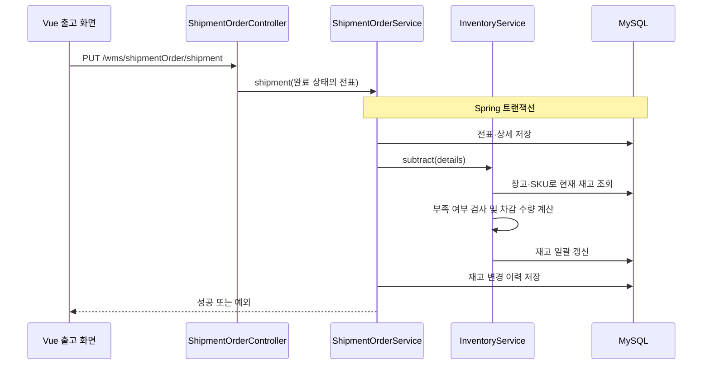
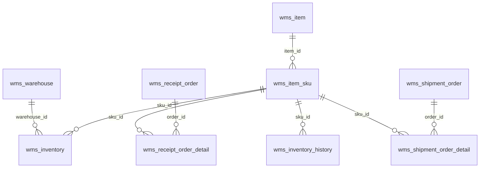

# 업무 흐름과 데이터 모델

## 출고 시 호출 흐름

입고는 `ReceiptOrderController` → `ReceiptOrderService.receive` →
`InventoryService.add`를 거쳐 재고를 늘리고 이력을 저장한다.

## 핵심 테이블 관계

아래는 코드와 컬럼에 따른 **논리적 관계**이며, DB 외래키 제약의 존재를 의미하지 않는다.

- 품목(item): 상품의 공통 정보.
- SKU(item_sku): 실제 재고를 관리하는 규격 단위.
- 재고(inventory): 창고별 SKU 현재 수량.
- 전표(order): 입출고 업무 한 건의 번호·상태·거래처 등.
- 전표 상세(order_detail): 업무에 포함된 SKU와 수량.
- 재고 이력(inventory_history): 업무로 인해 변경된 재고의 추적 기록.

## 설명할 핵심

현재 재고 숫자만 맞는 것으로 충분하지 않다. 전표 처리 결과와 이력이 함께 맞아야 한다.
트랜잭션은 여러 쓰기의 원자성을 위한 장치이고, 동시 출고 시 초과 출고 방지는 별도의
동시성 검증이 필요하다. 둘을 같은 보장으로 설명하지 않는다.
